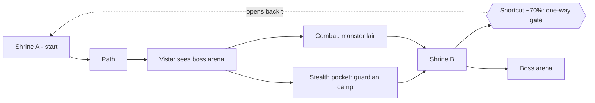

# Zone 01 (name TBD)

Owners: P (layout & gameplay sections) · A (visual sections) · Status: bubble diagram due week 3, greybox week 4

## Role in the game
_(Which part of the story? The theft/opening? First monster zone? Decide during scope lock.)_

## Bubble (molecule) diagram — P
Nodes are spaces, edges are connections. Mark one-way links with →.

## Layout checklist — P
- [ ] One critical path, 2–3 optional loops.
- [ ] One one-way shortcut at ~70% of the way, opened from the far side, looping to a shrine.
- [ ] An early vista that shows the boss arena and a later area.
- [ ] One ability gate that also opens a stealth route (e.g. a cat-assisted route).
- [ ] Greybox built to `ART_SPEC.md` metrics.

## Stealth pocket: see → plan → execute — P
- [ ] **See:** an elevated overlook that shows patrols before the player commits.
- [ ] **Plan:** at least 2 routes — high (rooftops) and low (grass, crawlspace, water).
- [ ] Patrols are readable loops with predictable pauses.
- [ ] Sightlines shown as lantern pools.
- [ ] **Execute / recover:** hide spots and line-of-sight breaks if detected.
- [ ] Every guardian can be passed non-lethally (takedown or avoidance).

## Visual sections — A
- Mood / time of day / weather:
- Landmark (visible from everywhere):
- Kit pieces needed (shrine, rocks, trees, …):
- Color script beat:

## Scene files
`scenes/levels/zone01/Zone01.tscn` (P) instancing `Zone01_Gameplay.tscn` (P), `Zone01_Art.tscn` (A), `Zone01_Lighting.tscn` (A).
