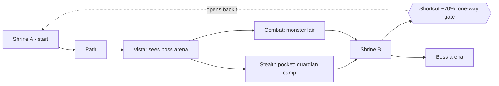

# Zone 01 (name TBD)

Owners: P (layout & gameplay sections) · A (visual sections) · Status: bubble diagram done; greybox slice built (week 4)

## Role in the game
_(Which part of the story? The theft/opening? First monster zone? Decide during scope lock.)_

## Bubble (molecule) diagram — P
Nodes are spaces, edges are connections. Mark one-way links with →.

## Layout checklist — P
- [x] One critical path: Shrine A → path → vista hall → stealth pocket **or** combat area → Shrine B hall → arena gate → boss arena. (The stealth/combat split is the first optional loop; 2–3 loops still to add with the vertical-slice scope.)
- [x] One one-way shortcut at ~70% of the way, opened from the far side, looping to a shrine (Shrine B hall → gate → west corridor → Shrine A court).
- [x] An early vista that shows the boss arena (vista platform, 6 m up: clear line of sight over the 3 m walls to the arena and its 16 m landmark tower). A "later area" preview is still to add.
- [ ] One ability gate that also opens a stealth route (e.g. a cat-assisted route) — needs the ability; not in the greybox yet.
- [x] Greybox built to `ART_SPEC.md` metrics: 2.4 m doorways, 0.35 m step-up (navmesh climb), 1.0 m crates, 2.2 m ledge-grab rooftops, 3 m walls, 1 m grid.

## Greybox slice (week 4) — P
Scenes: `scenes/levels/zone01/Zone01.tscn` (root) → `Zone01_Gameplay.tscn` (greybox collision, shrines, gate, spawns, stealth volumes, markers, navigation, HUD). `Zone01_Art.tscn` and `Zone01_Lighting.tscn` are A's and not made yet (request: `docs/requests/zone01_art_request.md`); until then `Zone01.tscn` has a node **`TEMP_PlaceholderLighting`** (WorldEnvironment + sun) to delete when `Zone01_Lighting.tscn` is instanced.

**Run it:** open `Zone01.tscn` in the editor and press **F6** (Run Current Scene), or `godot --path . res://scenes/levels/zone01/Zone01.tscn`. The sandbox stays the main scene.

Layout (metres, −Z = north; floors at y = 0 unless noted):
| Space | Area (x, z) | Contents |
|---|---|---|
| Shrine A court (start) | x −10…10, z −10…10 | Shrine A (start shrine, respawn point at the start), heroine spawn facing north. West exit = the shortcut's return. |
| Path | x −3…3, z −40…−10 | 2.4 m doorways at both ends. |
| Vista hall | x −12…12, z −70…−40 | 27° ramp up to the **vista platform** (y = 6, z −70…−62, 1 m parapet). Overlook west end looks into the stealth pocket; the arena is visible north-east. |
| Stealth pocket (west) | x −42…−18, z −60…−36 | Marked volumes only: overlook, high route (two 2.2 m rooftops), low route (tall grass strip), hide spot, two lantern pools, patrol loop. Guardians later. |
| Combat area (east) | x 18…42, z −60…−36 | Duelist (home at 30, −48), two cover pillars. |
| Shrine B hall | x −42…42, z −105…−85 | Shrine B (rest sets the respawn point). West exit = shortcut gate. |
| Shortcut | gate at (−45, −95); corridor west then south (x −53…−47) then east (z −3…3) to Shrine A court | One-way gate: opens only from the hall (far) side by `interact`. |
| Arena gate | x 28…32, z −115…−105 | 4 m wide: too narrow for the large-monster navmesh, so the boss stays in. |
| Boss arena | x 10…50, z −155…−115 | Monster #1 at the centre (30, −135), 16 m landmark tower at the north wall. |

Navigation: two navmeshes from the same source group (`NavSource`): human-size and large-monster, on separate navigation maps (`docs/COMBAT_SPEC.md` "Level navigation and the shortcut gate"). Walls, pillars and the landmark live under `Blockers` (outside the source group) and only carve the navmeshes through their footprints, so their tops are never walkable. Rebuild both after changing the greybox: `godot --headless --path . --script res://scripts/levels/rebuild_zone01_navmesh.gd` (regenerates the footprints, bakes with the gate closed).

Checked by `tests/smoke/zone01_smoke_test.gd`: loads with zero errors, both navmeshes have polygons, human path Shrine A → arena and up to the vista, vista line of sight to the arena, large agent paths inside the arena but not out, the gate opens only from the far side, resting at Shrine B sets the respawn point.

## Stealth pocket: see → plan → execute — P
- [ ] **See:** an elevated overlook that shows patrols before the player commits.
- [ ] **Plan:** at least 2 routes — high (rooftops) and low (grass, crawlspace, water).
- [ ] Patrols are readable loops with predictable pauses.
- [ ] Sightlines shown as lantern pools.
- [ ] **Execute / recover:** hide spots and line-of-sight breaks if detected.
- [ ] Every guardian can be passed non-lethally (takedown or avoidance).

## Visual sections — A
- Mood / time of day / weather:
- Landmark (visible from everywhere):
- Kit pieces needed (shrine, rocks, trees, …):
- Color script beat:

## Scene files
`scenes/levels/zone01/Zone01.tscn` (P) instancing `Zone01_Gameplay.tscn` (P), `Zone01_Art.tscn` (A), `Zone01_Lighting.tscn` (A). Gameplay exists (greybox slice); Art and Lighting are requested in `docs/requests/zone01_art_request.md`.
